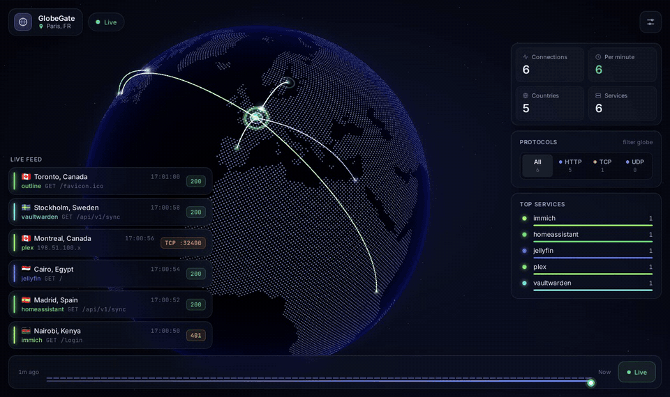

# GlobeGate

**A live 3D globe of every connection to your server.** HTTP requests from your reverse proxy and raw TCP/UDP connections (SSH, VPN, game servers…) are geolocated and drawn as arcs landing on your server, in real time.

[](https://github.com/CorentinGrard/globegate/actions/workflows/ci.yml)
[](https://github.com/CorentinGrard/globegate/actions/workflows/publish.yml)
[](https://github.com/CorentinGrard/globegate/releases)
[](LICENSE)



## Features

- **Live globe**: every connection draws an arc from the visitor's city to your server, colored by service.
- **More than HTTP**: reads Traefik's access log for web requests *and* the kernel's connection table for everything else: SSH, WireGuard, Minecraft, Plex…
- **Works behind NAT**, including double NAT, as long as ports are forwarded.
- **Insights**: requests per minute, protocol filter (HTTP / TCP / UDP), top services, top countries, status codes.
- **History**: a timeline to replay any moment of the last 7 days (configurable).
- **Private by default**: GeoIP lookups run locally (MaxMind GeoLite2), visitor IPs are masked in the UI, no third-party requests from the page.
- **Small and self-contained**: one container, SQLite storage, amd64 and arm64 images.

## Quick start

You need Docker with Compose v2 and a free [MaxMind license key](https://www.maxmind.com/en/geolite2/signup) for geolocation.

```bash
mkdir globegate && cd globegate
curl -fsSLO https://raw.githubusercontent.com/CorentinGrard/globegate/main/compose.yaml
curl -fsSL  https://raw.githubusercontent.com/CorentinGrard/globegate/main/.env.example -o .env
```

Edit `.env`: set your server's location (`SERVER_LAT`, `SERVER_LON`, `SERVER_LABEL`) and `MAXMIND_LICENSE_KEY` / `MAXMIND_ACCOUNT_ID`. Then point the Traefik log volume in `compose.yaml` at your Traefik logs, and start it:

```bash
docker compose up -d
```

Open `http://<your-server>:3000`. With no data source available yet, GlobeGate runs a demo with fake traffic so you can check everything works.

> **Images**: `ghcr.io/corentingrard/globegate:latest` (latest release), `:1` / `:1.2` / `:1.2.3` (pinned), `:edge` (main branch).

## Data sources

GlobeGate combines two sources. Use either or both.

### HTTP requests (Traefik)

Enable JSON access logs in Traefik:

```yaml
# traefik.yml
accessLog:
  filePath: /var/log/traefik/access.log
  format: json
```

Mount that directory read-only at `/logs` in the GlobeGate container (see `compose.yaml`). Each request shows its router (service), status code, method and path; query strings are always stripped.

If Traefik sits behind another proxy (Cloudflare, a load balancer), keep the client IP headers so GlobeGate sees the real visitor:

```yaml
accessLog:
  format: json
  fields:
    headers:
      names:
        X-Forwarded-For: keep
        Cf-Connecting-Ip: keep
```

### Every TCP/UDP connection (conntrack)

Traefik only knows about requests it proxies. GlobeGate can also show **every inbound TCP/UDP connection to the host** by reading Linux's connection-tracking table, the same table the kernel uses for NAT and Docker port publishing. The default `compose.yaml` enables it:

```yaml
network_mode: host   # see the host's connections, not just the container's
cap_add:
  - NET_ADMIN        # required to read connection-tracking events
```

- Needs rootful Docker. In rootless Docker/Podman, GlobeGate logs why conntrack is unavailable and carries on with the other sources.
- With `network_mode: host` the UI is served directly on the host's port 3000 (no `ports:` mapping). If Traefik proxies GlobeGate, point it at the host IP rather than the container name.
- Don't want this? Remove those two keys and add `ports: ["3000:3000"]`.
- With host networking, port 3000 is open on **every interface of the host**. If a reverse proxy handles access control, don't let the LAN bypass it. See [Behind Traefik with host networking](#behind-traefik-with-host-networking).

What gets shown:

- **TCP** once the handshake completes, so port scans against closed ports don't flood the globe. **UDP** on the first packet of a new flow.
- Only connections **from public IPs to this host**. Outbound traffic and private ranges are ignored.
- Ports `80,443` are skipped by default since the Traefik log already shows those requests in more detail (`CONNTRACK_IGNORE_PORTS`).
- The same IP and port appears at most once every 30 s (`CONNTRACK_DEDUPE_SECONDS`).
- Common ports are named automatically (22 → `ssh`, 51820 → `wireguard`…); add your own with `CONNTRACK_PORT_NAMES=25565:minecraft,2456:valheim`.

#### Behind Traefik with host networking

A container using `network_mode: host` can't join Traefik's Docker network. Traefik's Docker provider still routes to it via `host.docker.internal`:

1. Let the Traefik container resolve the host by adding this to **Traefik's** service:

   ```yaml
   extra_hosts:
     - host.docker.internal:host-gateway
   ```

2. Make GlobeGate listen only on the Docker bridge address, so it's reachable from containers (Traefik) but not from the LAN. Find it with `ip -4 addr show docker0` (usually `172.17.0.1`) and set it in `.env`:

   ```env
   LISTEN_ADDRESS=172.17.0.1
   ```

3. Keep your usual Traefik labels on GlobeGate, without `networks:`:

   ```yaml
   labels:
     - traefik.enable=true
     - traefik.http.routers.globegate.rule=Host(`globe.example.com`)
     - traefik.http.services.globegate.loadbalancer.server.port=3000
   ```

If Traefik returns a 502, a host firewall (ufw, firewalld) is probably blocking traffic from Docker networks to port 3000 on the host.

#### Behind NAT / double NAT

This works behind one or more NAT layers **as long as each router port-forwards (DNAT) to the next hop**. Port forwarding rewrites only the destination, so the visitor's public IP is still the source when the packet reaches your server.

| Setup | Real visitor IPs? |
|---|---|
| Port forwarding on every router (single or double NAT) | ✅ |
| Router "DMZ" mode | ✅ |
| VPS + WireGuard with plain DNAT (no `MASQUERADE` on the VPS) | ✅ |
| VPS relay using `MASQUERADE`/SNAT, frp, rathole, nginx `stream` | ❌ only the VPS (unless PROXY protocol is used) |
| Cloudflare Tunnel | HTTP only, through the Traefik log headers |

To check, connect from outside (e.g. SSH from your phone on mobile data) and run on the host:

```bash
sudo conntrack -L -p tcp --dport 22
```

If `src=` shows your phone's public IP, GlobeGate will too. If it shows a private address like `192.168.x.x`, a router is rewriting the source. Look for an "SNAT" or "masquerade" option on its forwarding rule.

## Configuration

All settings are environment variables (see [`.env.example`](.env.example)).

| Variable | Default | Description |
|---|---|---|
| `SERVER_LAT` / `SERVER_LON` | `48.8566` / `2.3522` | Where arcs land |
| `SERVER_LABEL` | `My Server` | Label shown in the header |
| `MAXMIND_LICENSE_KEY` | — | Downloads GeoLite2-City at start and refreshes it weekly |
| `MAXMIND_ACCOUNT_ID` | — | Recommended with the key: uses MaxMind's authenticated download endpoint |
| `IP_DISPLAY` | `masked` | What viewers see: `masked` (`203.0.113.x`), `full` or `hidden` |
| `IGNORE_IPS` | — | IPs/CIDRs dropped before storage, e.g. uptime monitors |
| `IGNORE_HOSTS` | — | Hostnames whose current IPs are dropped, e.g. your own domain (see [Hide your own traffic](#hide-your-own-traffic)) |
| `IGNORE_PATHS` | — | HTTP path prefixes to drop, e.g. `/health,/_health,/ping` |
| `RETENTION_DAYS` | `7` | How long history is kept |
| `CONNTRACK` | `auto` | TCP/UDP source: `auto`, `true` (log an error if unavailable) or `false` |
| `CONNTRACK_IGNORE_PORTS` | `80,443` | Ports to skip |
| `CONNTRACK_ONLY_PORTS` | — | Only show these ports |
| `CONNTRACK_DEDUPE_SECONDS` | `30` | Show the same IP and port at most once per N seconds |
| `CONNTRACK_PORT_NAMES` | — | Extra port names, e.g. `25565:minecraft` |
| `DEMO` | `auto` | Fake traffic: `auto` (only when no source is available), `true` or `false` |
| `PORT` | `3000` | HTTP/WebSocket port |
| `LISTEN_ADDRESS` | all interfaces | Listen only on this address, e.g. the Docker bridge IP `172.17.0.1` (see below) |
| `TRAEFIK_LOG_PATH` | `/logs/access.log` | Traefik log inside the container |
| `GEOIP_DB_PATH` | `/geoip/GeoLite2-City.mmdb` | GeoIP database inside the container |
| `DB_PATH` | `/data/connections.db` | SQLite history inside the container |

Already have a GeoLite2 database (e.g. from `geoipupdate`)? Mount it at `/geoip/GeoLite2-City.mmdb` and leave the MaxMind variables empty.

## Privacy and exposing the dashboard

GlobeGate shows who connects to your server. Before making it reachable from the internet:

- **Put it behind authentication** (e.g. Traefik's BasicAuth or ForwardAuth middleware, Authelia, Authentik) unless you really want a public page.
- Keep `IP_DISPLAY=masked` (the default) or `hidden`. Full IPs are stored in the local database for `RETENTION_DAYS` but never sent to viewers unless `IP_DISPLAY=full`.
- In the EU, IP addresses are personal data. Keep retention short and only collect what you need.

## Hide your own traffic

If your services or devices use your public URLs from inside your network (health checks, apps on your Wi-Fi, OIDC calls between services), the router sends that traffic back in through NAT loopback. It then arrives from **your own public IP**, and can easily make up most of the globe.

Set `IGNORE_HOSTS` to a DNS name that points at your public IP (your domain, or a DDNS name). GlobeGate resolves it every 5 minutes and drops traffic from that address, so it keeps working when your IP changes:

```env
IGNORE_HOSTS=home.example.com
```

Use a DNS-only record, not one proxied by a CDN. For health checks coming from outside (uptime services), drop their endpoints with `IGNORE_PATHS=/health,/_health,/ping`.

Token-like path segments (webhook IDs, invite links, UUIDs) are always masked as `•••` before anything is stored or shown.

## How it works

```
Traefik access.log (JSON) ──┐
                            ├─▶ Node.js ─▶ MaxMind GeoIP ─▶ SQLite + WebSocket ─▶ Three.js globe
Linux conntrack (TCP/UDP) ──┘
```

- **Backend** (Node.js 26, TypeScript): tails the Traefik log, streams `conntrack -E` events, geolocates public IPs offline, stores history in SQLite and broadcasts over WebSocket (`/ws`). REST: `/api/history`, `/api/density`, `/health`.
- **Frontend** (Vite, TypeScript, Three.js): dotted globe, animated arcs, live feed, stats and the history timeline.

## Development

See [CONTRIBUTING.md](CONTRIBUTING.md). In short:

```bash
cd backend  && npm ci && DEMO=true npm run dev   # API + WebSocket on :3000
cd frontend && npm ci && npm run dev             # UI on :5173, proxies to :3000
```

## Releases

Versions follow [Semantic Versioning](https://semver.org/); see the [CHANGELOG](CHANGELOG.md). Maintainers: the release procedure is in [RELEASING.md](RELEASING.md).

## License and credits

[MIT](LICENSE) © Corentin Grard

- This product includes GeoLite2 data created by MaxMind, available from [maxmind.com](https://www.maxmind.com). Use of GeoLite2 is subject to the [GeoLite2 EULA](https://www.maxmind.com/en/geolite2/eula).
- Land shapes from [Natural Earth](https://www.naturalearthdata.com/) (public domain).
- Built with [three.js](https://threejs.org/), [Vite](https://vite.dev/), [Inter](https://rsms.me/inter/) and [JetBrains Mono](https://www.jetbrains.com/lp/mono/).
